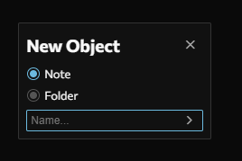
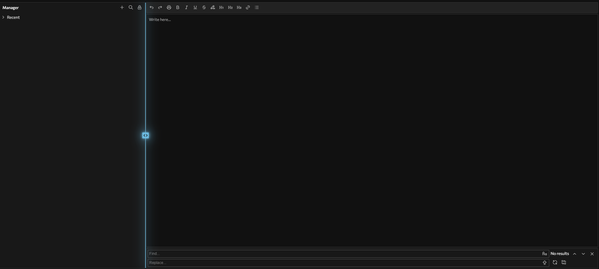
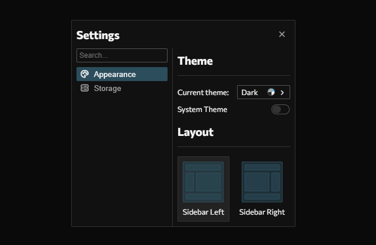

# Notes App

A work-in-progress project for capturing and managing notes. It aims to be an alternative to other bloated and slow notes apps.
With both desktop and mobile support in the works, it targets user-friendliness and functionality above all else.

## Why I made this

No other notes app I've found does what I want it to do in a way that makes sense, so I decided to make my own.

## Project status

The project is almost at a production state, with just a few pages of settings needing application programming and some small styling tweaks.
Any other features that have not been finished yet are not accessible by the user, but will be done in a later ship. These include find and replace and word counter.

## Demo Link
https://wcnotesapp.surge.sh/

## How to use
1. Visit the [demo link](https://wcnotesapp.surge.sh/).
2. Create a new note by clicking the + icon in the sidebar.

3. Type in main text area to edit the note.
4. Resize the sidebar by hovering over the gap in between panels:

5. Edit appearance by clicking the Settings option in the header.

;